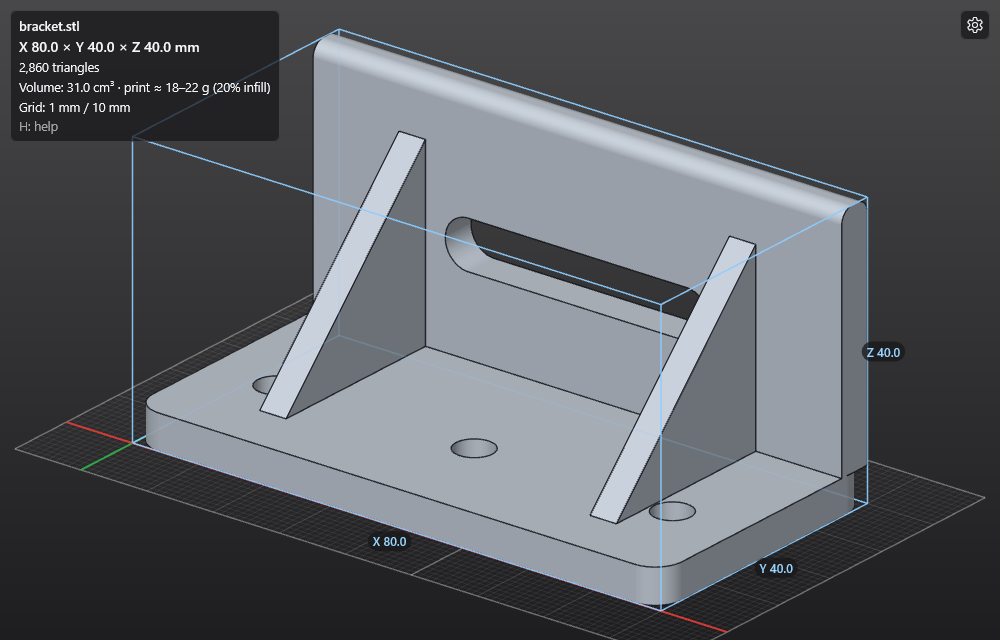

# SquarePeek

Free STL and 3MF thumbnails and a 3D preview pane for Windows File Explorer (Windows 10/11, x64). A lightweight
STL viewer for 3D printing: see a part's real size at a glance, on a measuring plate with its dimensions and an
approximate print weight. Works alongside Creality Print, OrcaSlicer, Bambu Studio, Cura and PrusaSlicer.

[Türkçe](README.tr.md)



## Features

- **Rotatable 3D preview** in Explorer's preview pane (`Alt+P`), drawn with Direct3D 11. Z up, model rests on the plate.
- **Measuring plate**: 10 mm grid starting at the model's corner, a 300 × 300 mm print bed outline, a bounding box with
  X / Y / Z dimensions, and a "does not fit" warning.
- **Info line**: size, triangle count, volume and print mass estimate (`print ≈ 76–93 g (20% infill)`).
- **Overhangs** (faces steeper than 45°), CAD-style **feature edges** and **wireframe**.
- **Open with** bar: the apps that can open the file (Creality Print, FreeCAD, Cura, …) as one-click buttons.
- **3MF** packages from Creality Print, OrcaSlicer and Bambu Studio (components, transforms, units).
- English UI, Turkish when Windows is set to Turkish. Settings are remembered.
- **Double-click is not changed**: your slicer still opens the file.

## Install

Download `SquarePeek-Setup-1.1.0.exe` from [Releases](../../releases) and run it (one UAC prompt).

- The installer is unsigned, so SmartScreen may warn: **More info → Run anyway**.
- The first preview after installing can take a few seconds while Windows Defender scans the new files.
- Existing thumbnail / preview handlers (e.g. Creality Print's) are backed up and restored on uninstall.
- Uninstall from **Settings → Apps → Installed apps**.

## Shortcuts

Click the preview once, then press `H` to see this list in the pane.

| Key / mouse | Action | Key | Action |
|---|---|---|---|
| Left drag | Rotate | `G` | Grid |
| Right / middle drag | Pan | `B` | Bounding box and dimensions |
| Wheel | Zoom | `P` | Print bed (300 mm) |
| Double-click | Reset view | `O` | Overhangs |
| `0` | Isometric | `E` / `W` | Edges / wireframe |
| `1`–`6` | Front, back, left, right, top, bottom | `R` | Auto-rotate |
| `Enter` | Open with default app | `I` / `A` | Info text / open-with bar |
| `C` | Copy size to clipboard | `H` | Help |

## Print mass estimate

Based on common slicer defaults (0.4 mm nozzle, 0.2 mm layers): 2 walls, about 0.8 mm top/bottom shell, 20% infill,
density 1.24 g/cm³. Shown as a ±10% range. It is a rough guide, not a slicer result.

## Build

Needs Visual Studio 2022 (C++ desktop workload, Windows SDK) and CMake 3.20+.

```
build.cmd              build into build\bin\Release
make-installer.cmd     build + installer into dist\ (needs NSIS 3)
build\bin\Release\stlprev-test.exe selftest
```

For a developer install without the installer: `install-machine.cmd` / `uninstall-machine.cmd`.
`stlprev-setup status` shows which handler Explorer actually uses.

## How it works

`STLPreview.dll` implements `IThumbnailProvider` and `IPreviewHandler`. Setup writes the two COM classes and the
`.stl` / `.3mf` `shellex` handler links under `HKLM\Software\Classes`, plus the extensions' ProgIDs
(e.g. `stl_cxsw`), because the shell picks the ProgID's handler first. ProgID defaults, `UserChoice` and
`OpenWithProgids` are never touched. Replaced handler values are saved in `HKLM\Software\STLPreview\ShellexBackup`
and written back on uninstall, only where the value still points to SquarePeek.

No network access, no telemetry; files are only read.

## License

MIT, see [LICENSE](LICENSE). Based on [DMarkovIT/thumbnail-stl](https://github.com/DMarkovIT/thumbnail-stl) (MIT).
