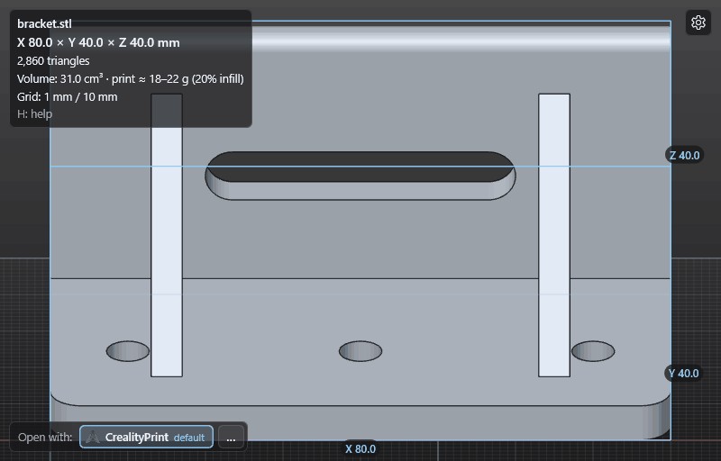

# SquarePeek

Windows Gezgini için STL ve 3MF küçük resimleri ve 3B önizleme bölmesi (Windows 10/11, x64).
Parçanın gerçek boyutunu bir bakışta görün: model, ölçüleri ve tahmini baskı gramıyla bir ölçüm tablasında durur.

[English](README.md)

## Özellikler

- Gezgin'in önizleme bölmesinde (`Alt+P`) **döndürülebilir 3B önizleme** (Direct3D 11). Z yukarı, model tablaya oturur.
- **Ölçüm tablası**: modelin köşesinden başlayan 10 mm ızgara, 300 × 300 mm baskı tablası, X / Y / Z ölçülü sınır
  kutusu ve "sığmıyor" uyarısı.
- **Bilgi satırı**: boyut, üçgen sayısı, hacim ve tahmini baskı kütlesi (`baskı ≈ 76–93 g (%20 dolgu)`).
- **Askıda yüzeyler** (45°'den dik), CAD tarzı **kenar çizgileri** ve **tel kafes**.
- **Birlikte aç** çubuğu: dosyayı açabilen programlar (Creality Print, FreeCAD, Cura, …) tek tıklık düğmeler olarak.
- Creality Print, OrcaSlicer ve Bambu Studio **3MF** paketleri.
- Windows Türkçeyse arayüz Türkçe, değilse İngilizce. Ayarlar hatırlanır.
- **Çift tıklama değişmez**: dosya yine dilimleyicinizle açılır.

## Kurulum

[Releases](../../releases) sayfasından `SquarePeek-Setup-1.1.0.exe` indirip çalıştırın (bir kez UAC onayı).

- Kurulum imzasızdır; SmartScreen uyarırsa **Ek bilgi → Yine de çalıştır**.
- Kurulumdan sonraki ilk önizleme, Windows Defender yeni dosyaları tararken birkaç saniye sürebilir.
- Var olan küçük resim / önizleme işleyicileri (ör. Creality Print'inki) yedeklenir, kaldırmada geri yüklenir.
- Kaldırma: **Ayarlar → Uygulamalar → Yüklü uygulamalar**.

## Kısayollar

Önizlemeye bir kez tıklayıp `H` tuşuna basınca liste bölmede görünür: sol sürükle döndür, sağ/orta sürükle kaydır,
tekerlek yakınlaştır, çift tık sıfırla, `0`–`6` hazır görünümler, `G` ızgara, `B` ölçüler, `P` tabla, `O` askıda
yüzeyler, `E` / `W` kenar / tel kafes, `R` otomatik döndürme, `I` / `A` bilgi / birlikte aç, `Enter` varsayılan
programla aç, `C` ölçüyü kopyala.

## Baskı kütlesi tahmini

Yaygın dilimleyici varsayılanlarına göre (0,4 nozul, 0,2 katman): 2 duvar, ~0,8 mm alt/üst kabuk, %20 dolgu,
1,24 g/cm³. ±%10 aralık olarak gösterilir; kaba bir tahmindir, dilimleyici sonucu değildir.

## Derleme ve teknik ayrıntılar

Derleme, geliştirici kurulumu ve kayıt defteri ayrıntıları için [İngilizce README](README.md).

## Lisans

MIT, bkz. [LICENSE](LICENSE). [DMarkovIT/thumbnail-stl](https://github.com/DMarkovIT/thumbnail-stl) (MIT) tabanlıdır.
